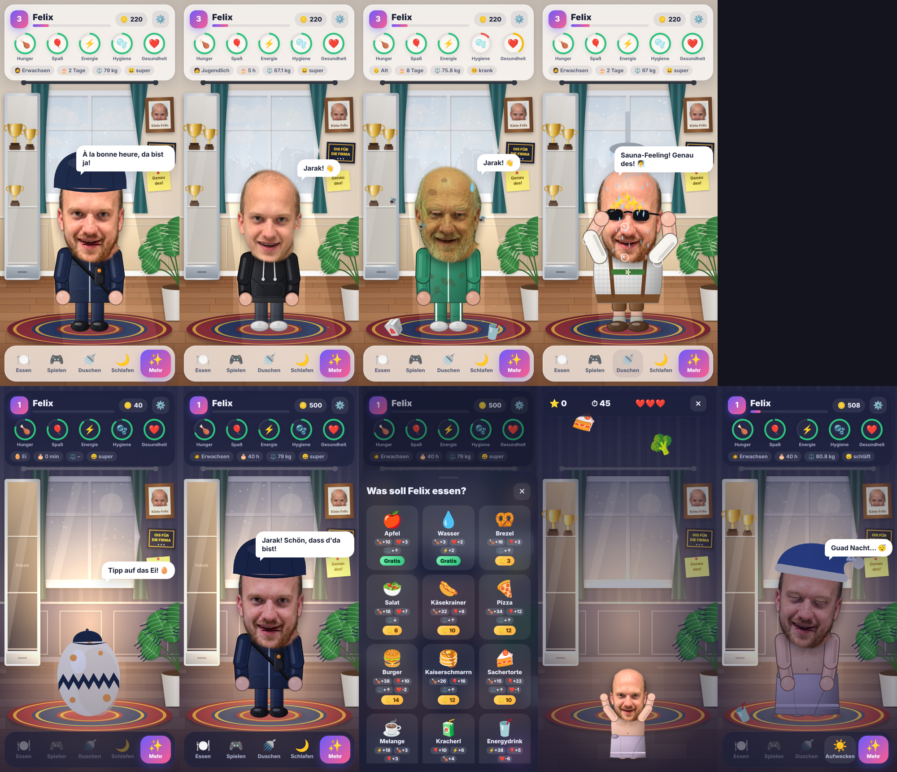

# Felix – das Tamagotchi 🧔

Ein virtuelles Haustier im Browser – mit Felix als Spielfigur. Felix schlüpft aus dem Ei und wächst über **Baby → Jugendlich → Erwachsen → Alt**, jeweils mit seinem echten Gesicht.

## Spielen

Einfach `index.html` im Browser öffnen – keine Installation, läuft auch offline.
Mit GitHub Pages (Settings → Pages → Branch `main`, Ordner `/`) ist es unter
`https://mhfsim.github.io/tamagotschi-/` direkt spielbar.

## Features

- 🍽️ Essen & Trinken (Käsekrainer, Kaiserschmarrn, Sachertorte, Melange, Seiterl …)
- 🎮 3 Minispiele: Würstel-Fangen, Blasen-Platzen, Reaktionstest
- 🚿 Duschen, 🌙 Schlafen, 💊 Medizin, 🏋️ Training, 🧹 Aufräumen
- 👔 Garderobe: Dienstjacke, Hoodie, Lederhose, Anzug, Sauna-Look, Kappe, Krone, Brillen …
- 🏆 16 Erfolge – die Pokale landen in der Vitrine
- 🌆 Raum mit Wien-Skyline, Tag/Nacht nach echter Uhrzeit und täglichem Wetter
- 💬 Felix' Sprüche: *Genau des! · Spalten! · Austrinken! · Genau mei Humor! · Jarak! · À la bonne heure! · Scheiß auf die Budde! · Ois für die Firma!*
- 💾 Spielstand bleibt gespeichert, die Zeit läuft weiter, während das Spiel zu ist

## Steuerung

| Aktion | So geht's |
|---|---|
| Streicheln | Auf Felix tippen |
| Spruch | Felix gedrückt halten oder *Mehr → Felix-Spruch* |
| Ei schneller ausbrüten | Aufs Ei tippen |
| Tempo zum Testen | ⚙️ → Tempo „Turbo“ |

## Technik

Eine einzige HTML-Datei: HTML, CSS, JavaScript und [PixiJS v8](https://pixijs.com) (MIT-Lizenz, eingebettet). Raum und Kleidung werden mit Canvas2D gemalt, Animationen laufen über WebGL.

Die Fotos von Felix werden mit seinem Einverständnis verwendet und sind nicht zur Weiterverwendung freigegeben.
